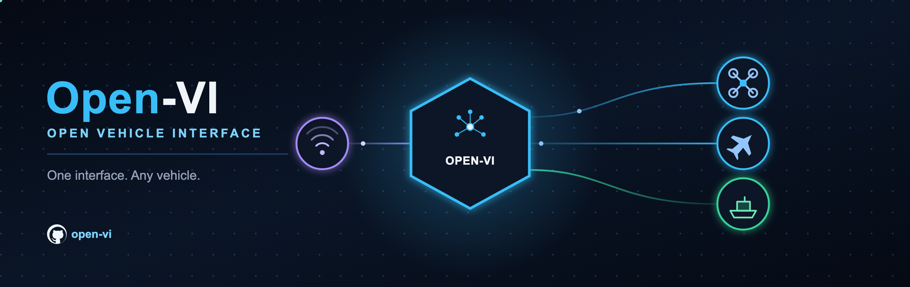

# open-vi



## Introduction

open-vi is an independent prototype: an ASK 5.0a Vehicle Interface. It is
owned by [OpenAutonomy](https://github.com/OpenAutonomy). It speaks native
UCI/A-GRA XML on the Abstract Service Bus.

It is one process: Isolator logic plus one vehicle backend behind
`PlatformPort`. Isolator owns A-GRA sequences, including the route ladder.
The default backend is `StubPlatform`. `Px4MavlinkAdapter` is a SITL cut
for telemetry, `WAYPOINT_FOLLOWING`, and `HSA_CSA`. A new vehicle is a
new adapter; it
is not a change to the Isolator.

Goals:

- Speak ASK 5.0a message types on the bus.
- Keep vehicle protocols (MAVLink, …) out of Isolator and codec.
- Extensibility: a new airframe is a `PlatformPort` implementation.

## Getting started

Clone the repository and install it. Python 3.11+ is required.

```bash
git clone https://github.com/OpenAutonomy/open-vi.git
cd open-vi
python3 -m venv .venv
source .venv/bin/activate
pip install -e ".[dev]"
```

The bus is deployed without authentication and without TLS. open-vi
can send STOMP credentials when a broker requires them; see
[SECURITY.md](SECURITY.md) and the
[configuration reference](docs/CONFIGURATION.md).

`open-vi` connects to the ASB at `BROKER_HOST` (default localhost):

```bash
open-vi
```

`--memory` uses an in-process bus (no broker). Isolator still runs
until interrupted.

Or the VI image:

```bash
BROKER_HOST=host.docker.internal docker compose -f compose/vi.yml up --build
```

CI publishes `ghcr.io/openautonomy/open-vi` from `main`. Either path
is Stub on STOMP `:61613`. PX4 SITL is `--platform px4` once a
vehicle is listening on `udpin:127.0.0.1:14540`. Optional vehicle
facts PX4 does not publish go in `--px4-config`. SITL and the
vehicle TOML are in the
[documentation](https://openautonomy.github.io/open-vi/).

```bash
pytest
```

## Standards

UCI and A-GRA XSD documents are not in the tree and are not
redistributed here. The codec is not an XSD binding; it builds
CAL-friendly XML. Namespace and schema version are in
`src/open_vi/codec/ns.py`.

Conformance is checked in two layers. The schema-independent layer runs
on every `pytest`: a byte-exact golden corpus of every message the VI
publishes, build/parse round-trips, structural invariants on the
envelope and header, and a check that FEATURES §1.3.1 matches the
implemented message set. The XSD layer validates that same corpus against the A-GRA catalog,
which is not vendored here — `oa-gateway` and `open-ma` already carry
it:

```bash
pip install -e ".[validate]"
UCI_XSD=../oa-gateway/schema/a-gra/A-GRA_MessageDefinitions_v5_0_a.xsd \
    pytest tests/test_wire_xsd.py
```

32 of the 36 published message types validate against A-GRA v5.0a
today. The four that do not are recorded in that module and fixed
separately. Without `UCI_XSD` those tests skip, so the suite is green
without the catalog. See the
[configuration reference](docs/CONFIGURATION.md).

## Documentation

[openautonomy.github.io/open-vi](https://openautonomy.github.io/open-vi/).

## Contributing

See [CONTRIBUTING.md](CONTRIBUTING.md).

## Changelog

Notable changes are in [CHANGELOG.md](CHANGELOG.md).

## License

Licensed under the [MIT License](LICENSE). Open source and free to use.
