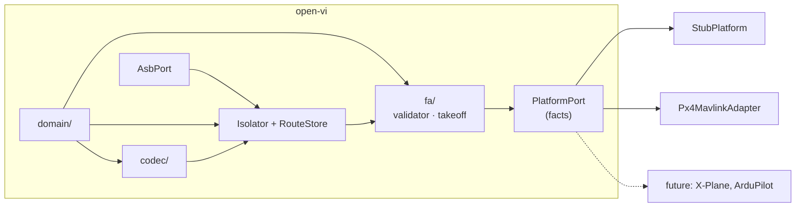

# Flight Autonomy layer — scope

Status: **proposed**. Nothing here is built. This is the shape and the
cut, so the decision can be argued before code exists.

## What FA is

Flight Autonomy is a thing the volume names, not an invention. §1.4
Table A-1-124 allocates 13 of its ~32 capability rows to it:

> Flight Autonomy includes Air Vehicle (AV) ... specific "aviate,"
> flight, and safety critical functions. Aviating includes autopilot
> functions and stable vehicle control to safely execute commanded
> paths, taxi, take-off, and landing.
>
> Flight and safety critical functions verify, bound, and recover safe
> flight. **The command validator** enables a separation of concerns
> between highly-assured flight and safety critical functions and
> mission behaviors. For example, it shields the autopilot from
> commands that would exceed operation limits or fly into terrain.

And the allocation to MA is written against it:

> MA commands are vetted by the FA command validator for safety
> compliance and MA itself does not command flight controls.

So FA is two things: **aviate**, and a **command validator**. An
autopilot does the first. Nothing in open-vi does the second today,
beyond the pure waypoint and HSA validators in `domain/flight.py`.

FA sits inside the Airworthiness Boundary:

> Systems assumed to be within this enclave could include the Vehicle
> Management System (VMS), Flight Autonomy (FA), or any other onboard
> system deemed safety-critical.

The isolator sits *at* that boundary as "the primary conduit".

## Why a package and not a repo

Every existing clone under `repos/` is a bus participant with its own
message face. FA has none:

> The MA-FA interface is contained within the MA-VI interface.

There are no FA topics to subscribe. A separate repo and container
would add a service with nothing to talk to, and a seventh box to the
demo. The logic is also pure — geometry and limit checks — which does
not need a process.

The volume permits either cut, and says so twice: "the definition of
the external-facing boundary of the VI OMS Isolator is a
platform-specific consideration potentially subject to certification",
and the validation strategy "could be federated between the VI OMS
Isolator and Flight Autonomy (FA)".

Extract it when one of these happens, not before:

1. An assurance or certification split lands. That is the real driver
   and it is a programme decision, not a code one.
2. FA must run as its own process at a different assurance level.
3. A second autopilot proves the facts interface wrong and it needs
   versioning independently of the isolator.

## Where it sits



The one structural change: **the isolator stops talking to
`PlatformPort` directly.** It states intent to FA; FA decides whether
the intent is flyable and how to express it to this airframe.

```
src/open_vi/fa/
  envelope.py   # the command validator §1.4 requires
  takeoff.py    # composes a takeoff route from facts
  port.py       # what FA needs of a platform
```

## What moves, and what the port becomes

`PlatformPort` has 11 methods today, and they mix two kinds of thing:
facts about the airframe, and actions on it. The split is the point.

| Stays a platform concern | Becomes an FA concern |
| --- | --- |
| Telemetry, faults, service and subsystem status | Whether a command is inside the envelope |
| Submitting a mission to the autopilot | Composing a takeoff route from runway geometry |
| Arming, if the airframe needs it | Deciding whether to arm, and when |
| Unit and frame conversion (HAE → relative) | Sequencing takeoff: validate, arm, fly, confirm airborne |

`domain/airfield.py`'s runway geometry moves behind `fa/`. Today it is
domain code that only `AirfieldReport` uses; as soon as takeoff needs
it, every adapter would otherwise re-derive it. X-Plane should cost a
facts adapter, not a route generator.

New facts the port must supply, which it does not today: runway
heading, envelope limits, whether the airframe needs arming, and
whether it can hold a mission.

## Two invariants, enforced

1. The isolator imports no platform module.
2. `fa/` imports no codec and no bus.

Neither is enforced today. `isolator/executive.py` claims it "never
imports STOMP, ActiveMQ, MAVLink, PX4, or Stub" and the only check is
`test_isolator_module_does_not_import_stub`, which asserts one name is
absent from one module's `__dict__`. The code happens to be clean. An
AST walk over the package would make both real, and it is worth doing
before `fa/` exists rather than after.

Invariant 2 is what keeps extraction a move rather than a rewrite.

## First job: takeoff

Takeoff is the reason this is being scoped now, and the volume is
specific about it. §1.2.5.1:

> In order to activate takeoff, MA will send
> `MA_MissionPlanActivationCommand` with the `BySubPlan` field
> populated, referring to the takeoff `MA_RouteActivityPlan` stored on
> FA.

§1.2.5.2 gives the reason:

> MA may not send new `MA_RoutePlanMT`s to FA related to takeoff,
> departure, approach, or landing, as those are considered safety
> critical. For those phases of flight, MA must activate one of the
> pre-planned, safety-validated takeoff, departure, approach, and/or
> landing Route Plans stored pre-flight on FA.

So takeoff is an **activation of a route the VI already holds**, not a
separate command. Four consequences:

1. FA offers the stored takeoff route; it does not arrive by upload.
   It is derived from where the vehicle actually is, so nothing is
   pinned to one airfield.
2. It enters `RouteStore` already `READY_FOR_ACTIVATION` — there is no
   upload ladder to walk, because §1.2.5.2 forbids MA uploading it.
3. `RouteStore` must mark it FA-owned so an MA upload cannot overwrite
   a takeoff route. That is the safety property §1.2.5.2 protects.
4. Discovery is already solved: `AirfieldReport` publishes
   `takeoff_route_id`.

`parse_route_activation_commands` already reads the
`RoutePlan/{RoutePlanID, CommandType}` that `BySubPlan` carries, so the
message face needs little. What it does not read is the `BySubPlan`
wrapper itself, which is how it would know this is a takeoff rather
than an ordinary activation. That is one of the seven inbound gaps in
`tests/test_wire_inbound_fields.py`.

## Open questions

- **Runway heading.** `domain/airfield.py` hardcodes
  `_DIRECTION_DEG = 90.0`. A derived takeoff route therefore departs
  due east regardless of wind. The VI already publishes a wind
  estimate in `WeatherObservation`; whether FA should use it is a
  decision, not an oversight.
- **How much validator.** §1.4 asks it to shield the autopilot from
  commands that "exceed operation limits or fly into terrain". Limits
  are reachable from `MA_FlightCapability`. Terrain is not — the
  terrain interactions are Not supported, so terrain-aware validation
  is out of scope until there is a terrain source.
- **Arming policy.** `REQ-SYS-0004` said the VI shall not command arm
  or launch. It is a product rule that contradicts §1.2.5.1, and the
  decision taken is that the standard wins, so it is withdrawn. Note
  that `docs/architecture.md` in the demo already showed VI arming
  while `README.md` said it never does; those need reconciling.

## What this is not

Not a second process, not a bus participant, not a certification
artifact, and not a terrain-aware validator. It is the place the
aviate-adjacent decisions live so they are written once instead of
once per autopilot.
