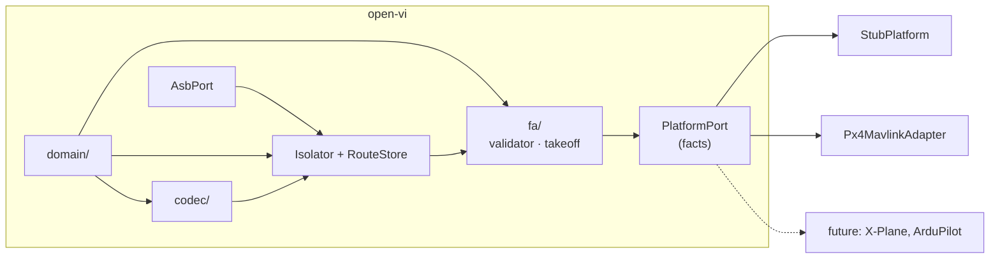

# Flight Autonomy layer — scope

Status: **proposed**. Nothing here is built. This is the shape and the
cut, so the decision can be argued before code exists.

## What FA is

Flight Autonomy is a thing the volume names, not an invention. §1.4
Table A-1-124 allocates 13 of its ~32 capability rows to it:

> Flight Autonomy includes Air Vehicle (AV) ... specific "aviate,"
> flight, and safety critical functions. Aviating includes autopilot
> functions and stable vehicle control to safely execute commanded
> paths, taxi, take-off, and landing.
>
> Flight and safety critical functions verify, bound, and recover safe
> flight. **The command validator** enables a separation of concerns
> between highly-assured flight and safety critical functions and
> mission behaviors. For example, it shields the autopilot from
> commands that would exceed operation limits or fly into terrain.

And the allocation to MA is written against it:

> MA commands are vetted by the FA command validator for safety
> compliance and MA itself does not command flight controls.

So FA is two things: **aviate**, and a **command validator**. An
autopilot does the first. Nothing in open-vi does the second today,
beyond the pure waypoint and HSA validators in `domain/flight.py`.

FA sits inside the Airworthiness Boundary:

> Systems assumed to be within this enclave could include the Vehicle
> Management System (VMS), Flight Autonomy (FA), or any other onboard
> system deemed safety-critical.

The isolator sits *at* that boundary as "the primary conduit".

## Why a package and not a repo

Every existing clone under `repos/` is a bus participant with its own
message face. FA has none:

> The MA-FA interface is contained within the MA-VI interface.

There are no FA topics to subscribe. A separate repo and container
would add a service with nothing to talk to, and a seventh box to the
demo. The logic is also pure — geometry and limit checks — which does
not need a process.

The volume permits either cut, and says so twice: "the definition of
the external-facing boundary of the VI OMS Isolator is a
platform-specific consideration potentially subject to certification",
and the validation strategy "could be federated between the VI OMS
Isolator and Flight Autonomy (FA)".

Extract it when one of these happens, not before:

1. An assurance or certification split lands. That is the real driver
   and it is a programme decision, not a code one.
2. FA must run as its own process at a different assurance level.
3. A second autopilot proves the facts interface wrong and it needs
   versioning independently of the isolator.

## Where it sits



The one structural change: **the isolator stops talking to
`PlatformPort` directly.** It states intent to FA; FA decides whether
the intent is flyable and how to express it to this airframe.

```
src/open_vi/fa/
  airfields.py  # the pre-validated airfield and TO/L route store
  envelope.py   # the command validator §1.4 requires
  vetting.py    # the check seam; approves everything for now
  launch.py     # sequences: vet, arm, fly, confirm airborne
  port.py       # what FA needs of a platform
```

## The axes that actually vary

Getting this cut wrong is expensive the first time a new integration
appears, so it is derived from what varies rather than from what looks
tidy.

| What | Varies with | Lives |
| --- | --- | --- |
| Transport | autopilot | adapter |
| Mission encoding, arming handshake, mode machine | autopilot | adapter |
| Frame conventions (HAE to relative-to-home) | autopilot | adapter, as `architecture.md` already requires |
| The airfield, runway and TO/L routes | where it operates | the airfield store, data shipped with the deployment |
| Mass, thrust, stall speed, rate limits | this airframe | config, already `px4-vehicle.toml` |

Two cost tests follow, and they are the acceptance criteria for this
design:

1. **A new autopilot, same airframe** -- X-Plane flying the same fixed
   wing -- must touch only the first three rows. It must not re-derive
   a takeoff route or restate an envelope policy.
2. **A new airframe, same autopilot** -- a multirotor on PX4 -- must
   touch only the last two. In particular **it must not require
   editing the PX4 adapter.**

The second is the expensive one and the one to design against. It is
also easy to fail silently: the first multirotor will work if you
special-case it, and the cost only shows up at the second.

## The rule: the port reports, FA decides, neither branches on identity

- The port may **report** the airframe type. PX4 knows its `MAV_TYPE`.
  Reporting is fine; branching on it is not.
- `fa/` branches on **capability**, never on class or product:
  `can_hover`, `needs_ground_roll`, `can_start_mission_directly`. A
  VTOL both hovers *and* does a running takeoff, so class is a poor
  discriminator and capability is exact.
- No product name in `fa/`. No airframe policy in an adapter.

A capability is also where an (autopilot x airframe) quirk goes, and
those do exist. The point is that the adapter *declares* the quirk and
FA sequences around the declaration -- so FA gains no branch and the
adapter gains no policy.

### What this means for `PlatformPort`

Eleven methods today, mixing facts about the airframe with actions on
it. The split is the point.

| Stays a platform concern | Becomes an FA concern |
| --- | --- |
| Telemetry, faults, service and subsystem status | Whether a command is inside the envelope |
| Submitting a mission to the autopilot | Vetting the configured route before it flies |
| Arming -- the mechanism | Deciding whether to arm, and when |
| Unit and frame conversion | Sequencing: validate, arm, fly, confirm airborne |

New facts the port must supply and does not today: the capability set
above, envelope limits, and the airframe type as a reported fact.
`ControlOffer` and `FlightModeProfile` already carry limits in a
vehicle-neutral shape, so that channel exists.

`domain/airfield.py`'s runway geometry stays where it is for now.
With takeoff selecting pre-validated data, FA has no geometry to
compose and the only remaining caller is `AirfieldReport`.

## The airfield store

§1.2.6.3 is already built and already honest about this: its Execution
row is Partial because "the field is synthesized from first TSPI
(1,500 m, heading 90 degrees), not a surveyed airfield". The standard
asks for the opposite:

> MA can query Flight Autonomy (FA) for **pre-loaded and pre-validated**
> Airfield and Take off and Landing (TO/L) route information **stored
> within FA**. This data includes alternate airfields for emergency
> landings as well as optional alternate TO/L routes for a given
> airfield.

And the two messages are paired rather than independent:

> FA **shall** respond with MA_RoutePlanMT data structures, indicating
> TO/L routes... MA_RoutePlanMT must have a take-off path whose
> **AirfieldID and RunwayID match the data in AirfieldReportMT**.

So it is one body of data with two projections: `AirfieldReport` for
the runway geometry, `MA_RoutePlan` for the routes. Airfields hold
runways, runways hold TO/L routes, and the ids tie them together.

That makes the store the thing that makes the rest of `fa/` honest.
The takeoff route §1.2.5.1 activates comes from it rather than from a
separate config, and `domain/airfield.py`'s synthesised runway goes
away -- which is the only reason §1.2.6.3's Execution is Partial.

Not a database. "Pre-loaded and pre-validated" means data files read
at startup and shipped with the deployment, on the same shelf as
`px4-vehicle.toml`.

Validation is the supplier's responsibility: whoever puts a route in
the store is the one who validated it. FA loads what it is given and
checks nothing about provenance.

Which means `fa/` must not *claim* the data is validated. "Pre-validated"
in §1.2.6.3 describes the deployment process, not a property open-vi
enforces, and the code should read that way -- the same reason the
vetting seam says plainly that it approves everything. A store named
`validated_routes` would be a lie; `configured_routes` would not.

Scope now versus what the standard anticipates: one airfield, one
runway, one takeoff route is a legitimate subset. The standard
expects alternates -- other airfields for emergency landings, and
alternate routes per airfield -- so the store's shape should allow
more than one of each even while the data has exactly one. Shape
costs nothing now; retrofitting a collection onto a singleton does.

## Vetting

**Vetting approves everything to begin with.** What is being built
first is the space and the interface, not the rules. That is a
deliberate choice and it carries one risk worth naming: a function
called `vet` that returns approval is easy to read as evidence a route
was validated. It is not. Until a rule exists, `vetting.py` is a seam
with nothing in it, and the doc and the code should both say so rather
than implying assurance by having the right-shaped module.

The first rule intended for it is the one that catches the failure
mode configuration actually has: the right route in the wrong place.
If the vehicle is not near the route's start, refuse. A config shipped
for one airfield and run at another is otherwise indistinguishable
from a correct setup, right up to the ground roll.

Tolerance is **5 m**, configured rather than constant. Worth knowing
why it is configurable: plain GNSS is 2-5 m CEP, so 5 m is near the
noise floor and a vehicle sitting correctly on the numbers can read as
out of position. If the rule starts refusing takeoffs that should pass,
the tolerance is the first thing to raise, not the rule to remove.

Shape, so that later rules cost nothing structural:

```python
Check = Callable[[Route, Facts], Reject | None]
```

Each check is pure, takes the route and the facts the port reported,
and returns a reason or nothing. `vetting.py` runs them in order and
stops at the first reason. Zero checks today, so the list is empty and
every route passes. The location rule is the first to add, the
envelope limits §1.4 asks for are next, terrain follows once there is
a terrain source -- and none of them changes the caller.

This is also the seam that grows into the command validator §1.4
describes -- same signature, applied to an `MA_FlightCommand` instead
of a stored route. Worth getting the shape right once.

A refusal has somewhere to go on the wire: the activation reply
carries a `CommandStatus` and a `CannotComplyType`, and
`CannotComplyEnum` has `INFEASIBLE_ROUTE` and `CONSTRAINT_ROUTE`
among its 46 values. So vetting is not a dead end that can only log --
MA is told why.

## Three invariants

1. The isolator imports no platform module.
2. `fa/` imports no codec and no bus.
3. No product name in `fa/`; no airframe policy in an adapter.

The first two are mechanical -- an AST walk over the package. The
third is review, and it is the one that will actually get broken, so
it is worth a name check for the obvious cases even though a
determined leak will slip past it.

None of them is enforced today. `isolator/executive.py` claims it
"never imports STOMP, ActiveMQ, MAVLink, PX4, or Stub" and the only
check is `test_isolator_module_does_not_import_stub`, which asserts
one name is absent from one module's `__dict__`. The code happens to
be clean. Doing this before `fa/` exists is cheaper than after.

Invariant 2 is what keeps a later extraction a move rather than a
rewrite. Invariant 3 is what keeps the second integration cheap.

## First job: takeoff

Takeoff is the reason this is being scoped now, and the volume is
specific about it. §1.2.5.1:

> In order to activate takeoff, MA will send
> `MA_MissionPlanActivationCommand` with the `BySubPlan` field
> populated, referring to the takeoff `MA_RouteActivityPlan` stored on
> FA.

§1.2.5.2 gives the reason:

> MA may not send new `MA_RoutePlanMT`s to FA related to takeoff,
> departure, approach, or landing, as those are considered safety
> critical. For those phases of flight, MA must activate one of the
> pre-planned, safety-validated takeoff, departure, approach, and/or
> landing Route Plans stored pre-flight on FA.

So takeoff is an **activation of a route the VI already holds**, not a
separate command. Four consequences:

1. The takeoff route is **configured, not computed and not uploaded**.
   §1.2.5.2 asks for "pre-planned, safety-validated" routes "stored
   pre-flight", and a route composed at runtime is validated by
   nobody -- which defeats the property that clause exists to protect.

   It comes from the airfield store, not from a config key of its own:
   §1.2.6.3 holds airfield geometry and TO/L routes as one
   pre-validated body of data, so a takeoff route living anywhere else
   would be a second source for the same thing. One airfield with one
   route is the data we ship; the store's shape allows more.

   Rejected on the way here, so they do not get re-proposed:
   deriving the route from `HomeAirfield`'s runway (assumes a fixed
   wing), deriving it capability-aware (still validated by nobody),
   and keying validated routes by airfield (an airfield database
   nobody needs).

2. It enters `RouteStore` already `READY_FOR_ACTIVATION` — there is no
   upload ladder to walk, because §1.2.5.2 forbids MA uploading it.
3. `RouteStore` must mark it FA-owned so an MA upload cannot overwrite
   a takeoff route. That is the safety property §1.2.5.2 protects.
4. Discovery is already solved: `AirfieldReport` publishes
   `takeoff_route_id`.

`parse_route_activation_commands` already reads the
`RoutePlan/{RoutePlanID, CommandType}` that `BySubPlan` carries, so the
message face needs little. What it does not read is the `BySubPlan`
wrapper itself, which is how it would know this is a takeoff rather
than an ordinary activation. That is one of the seven inbound gaps in
`tests/test_wire_inbound_fields.py`.

## Open questions

- **Where does the capability set come from?** PX4 can report
  `MAV_TYPE`, but `can_start_mission_directly` is a property of the
  autopilot's behaviour that someone has to assert. Discovered,
  configured, or hardcoded per adapter are all defensible.
- **How much validator?** §1.4 row 29 is a `shall` -- FA shall protect
  the aircraft from unsafe commands, naming g, rate and speed limits
  and stall-level energy management. Limits are reachable from
  `MA_FlightCapability`. Terrain is not, since the terrain
  interactions are Not supported. So: how far past limit checking do
  we go, and when?

## What this is not

Not a second process, not a bus participant, not a certification
artifact, not a terrain-aware validator, not an airfield database,
and -- until a rule is written -- not a validator at all, only the
place one goes. It is the place the
aviate-adjacent decisions live so they are written once instead of
once per autopilot.
