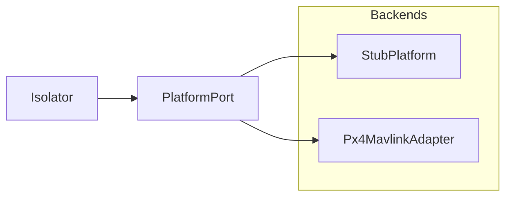

# Platform

`PlatformPort` is Isolator's vehicle face. Shared values live in
`open_vi.domain`. No UCI XML and no MAVLink types appear on this boundary.
The layers around it are in [ARCHITECTURE.md](ARCHITECTURE.md). A new
backend is a new implementation; see [ADDING_A_VEHICLE.md](ADDING_A_VEHICLE.md).

Only one backend is wired at a time. Isolator construction requires a
`PlatformPort` (CLI: `make_platform()`). Adapters do not implement the
A-GRA route ladder.

## Methods

| Method | Role |
| --- | --- |
| `snapshot()` | Control offer and readiness (advertise / tick) |
| `submit_flight_command()` | Accept or reject a flight command (Capability NEW/CANCEL or Activity UPDATE). Must return promptly — background the vehicle I/O and report failure through `poll_command_updates()` |
| `poll_command_updates()` | Terminal command states reached since last poll — mission completion, or a background execution failure/cancellation (default: none) |
| `active_flight_activity()` | Current activity for `MA_FlightActivity` |
| `get_vehicle_state()` | TSPI, airdata, components (`TspiSnapshot`) |
| `get_service_status()` | VI service heartbeat fields |
| `get_subsystem_status()` | Subsystem health |
| `get_faults()` | Fault list (a cleared sentinel is fine) |
| `apply_system_management()` | QNH → `COMPLETED` or `REJECTED` |
| `close()` | Release backend resources (default no-op; PX4 closes MAVLink) |

Isolator maps these domain structs to UCI through the codec. The route
ladder is `RouteStore` on Isolator, not this ABC. ACTIVATE and
DEACTIVATE call `submit_flight_command` with a waypoint path or
CANCEL. `inject_contingency` is Stub-only and stays off the port.

Isolator's inbound dispatch and periodic tick share one thread once
`start()` runs, so `submit_flight_command` must not block on vehicle
I/O — a slow call stalls every periodic publish until it returns.
`Px4MavlinkAdapter` validates synchronously (including that the
vehicle is already armed and airborne — it never arms or launches PX4
itself), accepts, then runs the mission upload on a background thread
and reports a background failure or cancellation through
`poll_command_updates()`.

## Backends

`StubPlatform` is the default for tests and `open-vi`. It is deterministic
state: accept/reject, TSPI, and status. Description is in
[platforms/stub](platforms/stub/README.md). Coverage is in
[platforms/stub/FEATURES.md](platforms/stub/FEATURES.md).

`Px4MavlinkAdapter` is telemetry, `WAYPOINT_FOLLOWING` (mission
upload, mission start — the vehicle must already be armed and
airborne), and `HSA_CSA` (offboard hold). Link, mission, offboard,
and telemetry are sibling modules under `src/open_vi/platform/px4/`.
Description and SITL are in [platforms/px4](platforms/px4/README.md).
Coverage is in [platforms/px4/FEATURES.md](platforms/px4/FEATURES.md).

`import open_vi.platform` loads the port and Stub. PX4 is imported only
inside `make_platform("px4")`.

## Route progress

``active_route_progress()`` reports where the vehicle is along the
waypoint list **as submitted**, not along whatever the backend
uploaded. A backend that trims or reorders owns the mapping back: PX4
drops a leading prefix it has already captured, so its MAVLink
mission sequence ``k`` is submitted index ``skipped + k``.

``None`` means the backend cannot report it — nothing executing, or no
notion of position along a route. It is not a default of zero.
``RoutePlanExecutionStatus`` requires ``CurrentSegment``, and naming a
segment the vehicle is not at would be a navigational claim the VI has
not observed.

Progress deliberately outlives the live activity. §1.2.5.6 requires a
``RoutePlanExecutionStatus`` carrying ``CANCELED`` when the VI aborts,
and ``CurrentSegment`` is mandatory on it, so an aborted route still
has to say where it stopped.

The index is turned into a ``PathSegmentID`` by
``open_vi.codec.path.segment_id_for_index``, the same rule
``build_path_element`` uses, so a status message cannot name a segment
the route does not contain.
